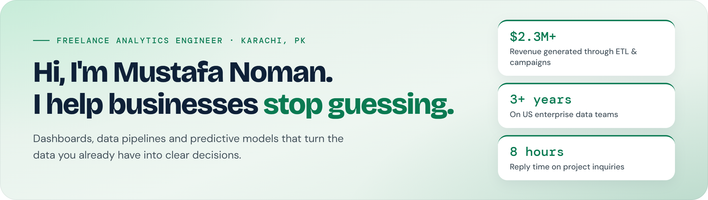
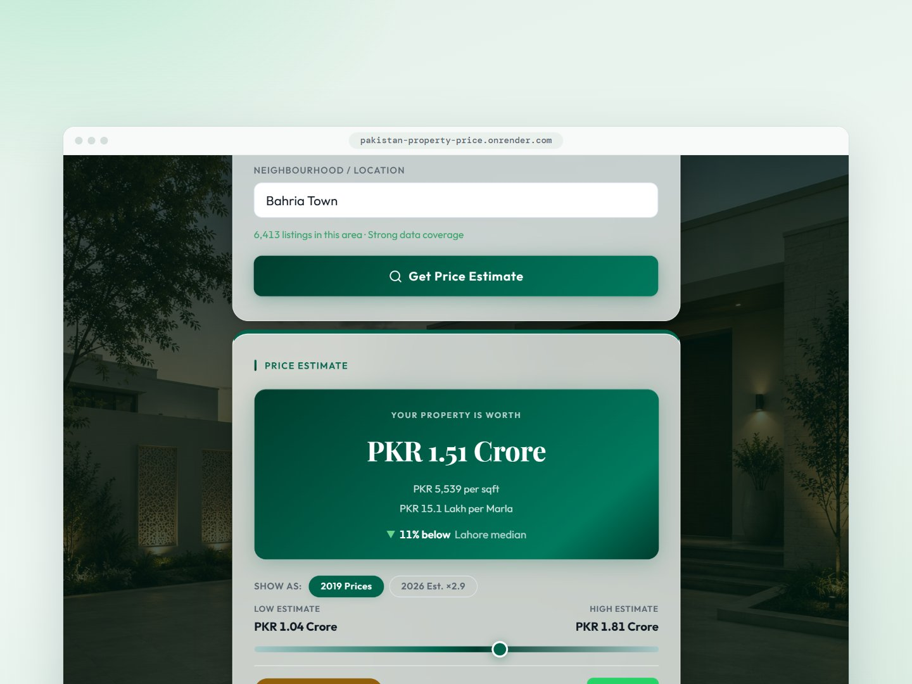
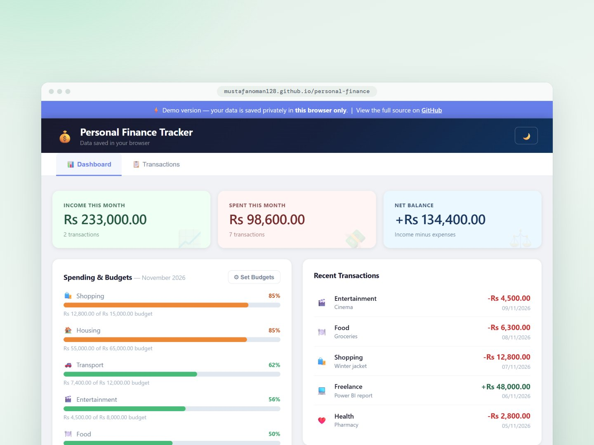

  
  
  
  
  
  

## 👋 Welcome

I'm Mustafa Noman, a freelance analytics engineer based in Karachi, Pakistan. For three-plus years I turned messy operational data into decisions leadership could act on, inside US enterprise teams at **Pregis**, **Stericycle** and **The Henry Ford**. Now I work directly with businesses.

Most businesses already have the data. The gap is a system that reads it clearly and tells you what to decide. I build that.

## 🛠️ What I do

- 📊 **Analytics & dashboards:** Power BI and Tableau dashboards that leadership actually uses
- 🔄 **Data & ETL engineering:** SQL, Python and Alteryx pipelines that clean and move data on their own
- 📈 **Predictive systems:** forecasts and price models that give a range, not one false number
- 🧩 **Web & data apps:** small tools that put the answer in front of the people who need it

## 🏆 Track record

- **$2.3M** in additional revenue from outbound campaigns and ETL workflows across 6 sales teams · *Stericycle*
- **7.1%** quarter-on-quarter lead growth from a 75+ KPI lead-funnel dashboard · *Pregis*
- **$20K** in compliance penalties prevented by fuzzy-matching 500K+ records · *The Henry Ford*

## 🚀 Featured work

**📊 [Chicago Cancer Center Performance Dashboard](https://github.com/mustafanoman128/ChicagoCancerCenter-CCC-)** 
Power BI dashboards for an oncology practice with $14.5M in revenue and 8,000+ patients: which clinics to consolidate, which providers were underperforming, and how the payer mix was shifting. 
`Power BI` `DAX` `SQL` `Power Query`

<table>
  <tr>
    <td width="50%" valign="top">
      
      
<b>Pakistan Property Price Estimator</b> 
      What a home is worth in seconds: a low estimate, a likely price and a ceiling. Trained on 120,000+ Zameen.com listings across five cities.

      
<code>Python</code> <code>LightGBM</code> <code>FastAPI</code>

      
<a href="https://pakistan-property-price.onrender.com/">Try it live</a> · <a href="https://github.com/mustafanoman128/pakistan-property-price">Code</a>

    </td>
    <td width="50%" valign="top">
      
      
<b>Personal Finance App</b> 
      Tracks income and spending, sets budgets and shows progress in real time. A full-stack app built from scratch with no framework.

      
<code>Node.js</code> <code>Express</code> <code>SQLite</code>

      
<a href="https://mustafanoman128.github.io/personal-finance/demo.html">Try it live</a> · <a href="https://github.com/mustafanoman128/personal-finance">Code</a>

    </td>
  </tr>
</table>

## 🧰 Toolkit

**Analytics & BI** 

**Data & cloud** 

**Data science & ML** 

**Apps & delivery** 

## 🎓 Education & certifications

- MSc Business Analytics, University of Illinois Chicago · BSc Economics, LUMS
- Alteryx Designer Core · Alteryx Machine Learning Fundamentals · Tableau Desktop Foundations

## 💬 What people say

> Mustafa is a remarkable professional and a genuinely great person to work with. … The clearest measure of his impact: the report format he developed became the template for multiple reports across our Tableau environment and continued to be used long after his contract ended.
>
> **Adelinne Hernandez Whittenhall**, Sr Business Development Analyst, Pregis · [Verified on LinkedIn](https://www.linkedin.com/in/mustafanoman128/details/recommendations/)

## 🤝 Let's work together

Have a data problem worth solving? I take on select projects where I can deliver measurable outcomes, and I reply to every project inquiry within 8 hours.

